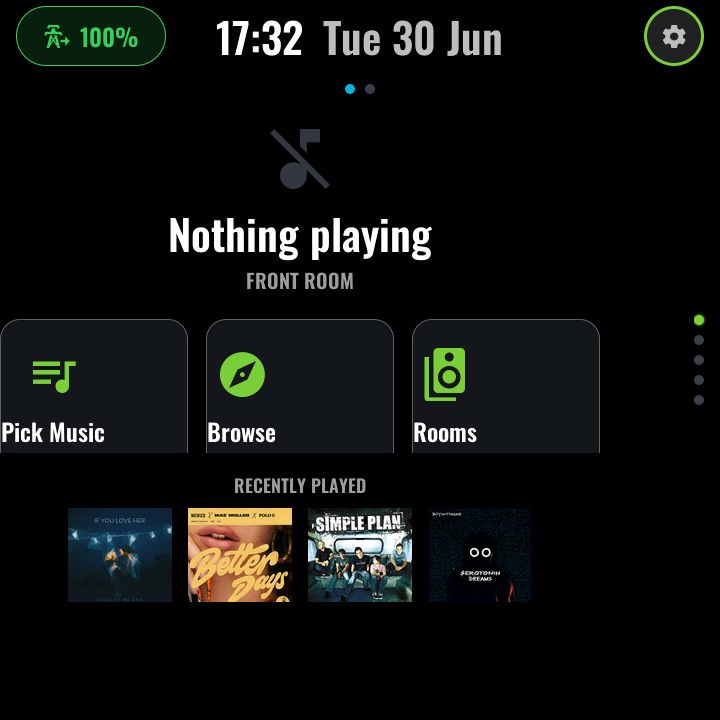

# ESP32-P4 Smart Panel

<p align="center">
  
</p>

A polished, fully local smart-home wall panel for the **Waveshare ESP32-P4-86-Panel**
(720×720 IPS touchscreen), built entirely with **ESPHome** and **LVGL 9**. One
firmware gives you a swipeable 2D grid of functions — music and multi-room audio,
climate and hot water, timers and alarms, a live energy Sankey, surf conditions, a
robot-vacuum controller and a terminal-style clock screensaver — plus an on-device
voice assistant with an animated persona overlay. Everything is driven by Home
Assistant entities that you bind in a single `user-config.yaml`, so the shared page
modules never need editing: copy the example config, point it at your entities, and
flash.

## Features

| | | |
|:---:|:---:|:---:|
| [](docs/pages/energy.md)<br>**Live energy Sankey** — PV, battery, grid, EV and heat-pump flows, plus a daily-totals view | [](docs/pages/media.md)<br>**Multi-room audio** — group speakers, per-room volume, now-playing dock | [](docs/pages/alarm.md)<br>**Alarms** — HA-backed roster with speaker, music and person pickers |
| [](docs/pages/timer.md)<br>**Timer** — aperture-iris countdown shared with voice | [](docs/pages/climate.md)<br>**Climate** — draggable target dial, heat-pump stats, hot-water boost | [](docs/pages/voice.md)<br>**Voice assistant** — wake word, animated persona overlay |
| [](docs/pages/screensaver.md)<br>**Screensaver** — monumental clock + two-day forecast | [](docs/pages/swelligence.md)<br>**Surf conditions** — manifest-driven spot pages | [](docs/pages/vacuum.md)<br>**Vacuum** — state hero, progress, routine picker |

## Hardware

- **Waveshare ESP32-P4-86-Panel** — ESP32-P4 (dual-core RISC-V, 32 MB flash,
  PSRAM), 720×720 IPS touchscreen in an 86-style wall-box form factor, with an
  onboard ESP32-C6 for Wi-Fi and Bluetooth (used as a BLE proxy), microphone and
  speaker for voice.
- **LVGL 9** UI rendered natively by ESPHome — no Home Assistant dashboard, no
  browser; the panel keeps working when the network does not.

See [docs/HARDWARE.md](docs/HARDWARE.md) for the full hardware notes.

## Quick start

1. **Get the hardware** — a Waveshare ESP32-P4-86-Panel and a USB-C cable for the
   first flash.
2. **Clone the repo**
   ```bash
   git clone https://git.bagofholding.co.uk/foolycooly/esp32-panel.git
   cd esp32-panel
   ```
3. **Copy the example configs**
   ```bash
   cp user-config.yaml.example user-config.yaml
   cp secrets.yaml.example secrets.yaml
   ```
4. **Edit them** — Wi-Fi and API key in `secrets.yaml`; your Home Assistant
   entities, room roster and panel identity in `user-config.yaml`
   (see [docs/CUSTOMISATION.md](docs/CUSTOMISATION.md)).
5. **Build and flash** with a local ESPHome on your workstation
   ```bash
   make compile                      # first build ~20-25 min, incremental ~5 min
   esphome run waveshare-p4-86-panel.yaml   # first flash over USB
   make flash DEVICE_IP=<panel-ip>   # later updates: compile + OTA
   ```
   Don't compile inside a shared server's ESPHome container — a cold build can
   exhaust the host (`make compile` refuses in container mode). Full walkthrough,
   including the Home Assistant-side template packages the pages expect, in
   [docs/INSTALLATION.md](docs/INSTALLATION.md).

## Documentation

- [Installation](docs/INSTALLATION.md) — hardware, secrets, HA prerequisites, first flash
- [Customisation](docs/CUSTOMISATION.md) — `user-config.yaml` walkthrough, multi-panel setups, codegen, dev tooling
- [Hardware](docs/HARDWARE.md) — what the hardware module configures and why
- [Screens](docs/pages/README.md) — one page per screen, with screenshots and entity tables
- [Font inventory](docs/font-inventory.md) · [LVGL object budgets](docs/lvgl-object-budgets.md) · [Image retention strategy](docs/image-retention-strategy.md) — engineering notes

## Credits

This project stands on the shoulders of several excellent open-source projects —
the modular LVGL library by Andrew Gillis, the ESP32-P4-86 hardware baseline by
chrisdunnname, and an LVGL 9 port of dcgrove's screenshot component, among others.
Full attributions, licences and font credits are in [NOTICE.md](NOTICE.md).

## Licence

MIT — see [LICENSE](LICENSE). Third-party components retain their own licences as
detailed in [NOTICE.md](NOTICE.md).
