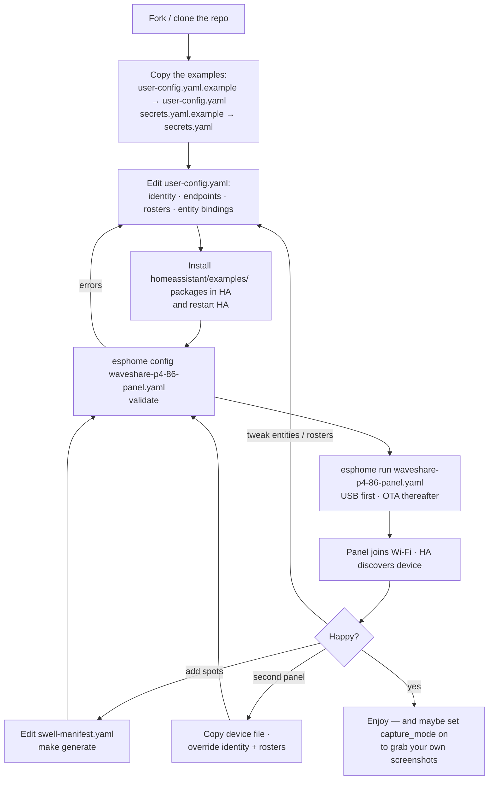

# Customisation

The design rule of this project is simple: **shared modules are never edited;
everything site-specific is a substitution**. Each page module ships generic
defaults and reads `${...}` substitutions for every external Home Assistant
entity it touches, so one copy of the page code serves any home — and any number
of panels. Your levers, from most- to least-often used:

1. **`user-config.yaml`** — your panel's identity, endpoints and entity bindings.
2. **The device file** (`waveshare-p4-86-panel.yaml`) — which pages are included
   and in what swipe order (the *composition root*).
3. **`swell-manifest.yaml`** — the surf-conditions spot roster (code-generated).

## user-config.yaml, group by group

Copy `user-config.yaml.example` to `user-config.yaml` and work through the
groups. Values shown are the shipped examples, which match the
`homeassistant/examples/` packages.

### Identity

| Substitution | What it does | Example |
|---|---|---|
| `name` | ESPHome node name. Also seeds the fallback-AP SSID and HA entity-id prefix | `livingroom-panel` |
| `friendly_name` | Display name in HA | `Living Room Panel` |
| `project_name` / `project_version` | Stamped into ESPHome project metadata | `you.living-room-panel` / `1.0.0` |
| `wifi_fallback_pwd` | Password for the recovery access point | `CHANGE-ME-fallback-ap-password` |
| `log_level` | Serial log verbosity. `INFO` compiles debug logging out; use `DEBUG` while diagnosing | `INFO` |

### Endpoints

| Substitution | What it does | Consumed by |
|---|---|---|
| `ha_base_url` | Your HA origin; runtime image fetches (album art, person photos) build URLs from it, and the voice stack uses it for external sounds | main, media, alarm |
| `imageproxy_url` | Optional image-resizing proxy (`GET <proxy>/<WxH>/<source-url>` returning a pre-sized JPEG). Saves the panel decoding full-size art over plain HTTP | main, media, alarm |

### Media binding (per panel)

Now-playing binds each roster room's `media_player.<slug>` directly (see
*Speaker room roster* below); the selected room is kept on the panel and
survives reboots. No HA mirror sensor or selection helper is needed.

| Substitution | What it does | Consumed by |
|---|---|---|
| `external_media_player` | Room slug seeding the *voice* target speaker on first boot (runtime-editable from HA afterwards) | voice stack |

### Spotify content feeds

`spotify_recent_entity`, `spotify_playlists_entity`, `spotify_artists_entity` —
the three cover-art feed sensors from `spotify_panel.yaml`. Defined once and
consumed by the main page's recent row, the Pick Music / Browse takeovers and
the alarm music picker, so the pickers can never drift apart. Panels normally
share one Spotify profile; point a panel at per-panel feed sensors to give it
its own.

### Speaker room roster

The multi-room grid renders a **fixed number of room tiles** (LVGL widgets are
created at compile time — the slot count is a hard constraint), but *which*
rooms fill the slots is your config. A "slug" is the entity id minus the
`media_player.` domain; the module rebuilds `media_player.<slug>`.

| Substitution | What it does |
|---|---|
| `media_local_slug` | *This* panel's default play target — the speaker in the same room |
| `media_room_0_slug` … `media_room_6_slug` | Entity slug per grid slot |
| `media_room_0_caption` … `media_room_6_caption` | Tile caption per slot |

Slot order also defines the topology→tile mapping, so keep slug/caption pairs
aligned. Live group state is derived on the panel from each room's
`group_members`, so only rooms in this roster are seen; adding a speaker means
editing the roster and re-flashing.

### Alarm speaker roster

The alarm speaker picker reuses the media roster's slugs (so the two can't
drift) with its own labels and MDI glyphs. Row 0 is always the panel's local
speaker.

| Substitution | What it does |
|---|---|
| `alarm_room_player` | Full entity id of this panel's own speaker (defaults to `media_player.${media_local_slug}`) |
| `alarm_local_label` | Label for the local room in the alarm UI |
| `alarm_row_0..5_slug` / `_label` / `_glyph` | Six picker rows: slug, caption and an `$mdi_*` glyph |

### Navigation contract

The 2D swipe grid (vertical = function, horizontal = page) is declared here —
the nav engine never hard-codes the layout. See
[pages/navigation.md](pages/navigation.md) for the model.

| Substitution | What it does |
|---|---|
| `nav_functions` | Number of function rows (≤ 5 — the position dots are fixed widgets) |
| `nav_pages_per_func` | Column dimension of the matrix (fixed cap of 4) |
| `nav_npages` | Page count per function, e.g. `"{2, 2, 2, 2, ${swell_npages}}"` |
| `nav_pages_matrix` | The function × page grid of page ids, HOME page first in row 0 |

Add, remove or reorder screens by editing this contract **and** the matching
`page_*` includes in the device file — nothing inside `nav2d.yaml` changes.

### Per-page bindings

Each page documents its own substitution table — see the
[screen documentation](pages/README.md). Highlights:

| Group | Substitutions | Page |
|---|---|---|
| Climate | `climate_entity`, `climate_min_temp`/`_max_temp`, `clim_outdoor_entity`, `clim_humidity_entity`, `clim_cop_entity`, `clim_pressure_entity`, `clim_qv_duration_entity` | [climate](pages/climate.md) |
| Hot water | `dhw_tank_temp_entity`, `dhw_setpoint_entity`, `dhw_boost_switch`, `dhw_wh_entity` | [hotwater](pages/hotwater.md) |
| Energy | `en_power_scale`, `en_batt_sign`, `en_grid_sign` (panel-side unit/sign normalisation), `en_pv_power_entity`, `en_consumed_power_entity` (optional), `en_grid_power_entity` (signed net), `en_ev_power_entity`, `en_hp_power_entity`, `en_solcast_remaining_entity`, `en_ev_status_entity`, `en_tesla_soc_entity`, `en_tesla_location_entity`, Energy-dashboard kWh counters `en_pv_energy_entity`, `en_grid_import_energy_entity`, `en_grid_export_energy_entity`, `en_batt_charge_energy_entity`, `en_batt_discharge_energy_entity`, optional `en_ev_energy_entity` / `en_hp_energy_entity` / `en_load_energy_entity` (`""` = none / derive load) (Today Sankey); shared `battery_power_entity` + `battery_soc_entity` (ui-shared, also feed the top-bar battery pill) | [energy](pages/energy.md) |
| Timer | `timer_entity` | [timer](pages/timer.md) |
| Screensaver | `weather_entity` | [screensaver](pages/screensaver.md) |
| Vacuum | `vacuum_entity` + the `vacuum_*_entity` status/fault set, `vacuum_nav_f`/`_p` | [vacuum](pages/vacuum.md) |
| Room | `room_nav_f`/`_p` (tile grid is still a stub) | [room](pages/room.md) |
| Main | `local_room_label` — room label shown above the now-playing dock | [main](pages/main.md) |
| People | `person_1..3_entity`/`_name` — person entities for the alarm per-person picker photos | [alarm](pages/alarm.md) |
| Alarm rooms | `alarm_row_1..6_slug`/`_label`/`_glyph` — speaker-room roster for the alarm speaker picker | [alarm](pages/alarm.md) |
| Lights (optional page) | `light_1..3_entity`/`_caption` — only consumed if the device includes `modules/page-lights.yaml` | — |
| Security (optional page) | `security_alarm_entity` — only consumed if the device includes `modules/page-security.yaml` | — |
| Vacuum routines | `routine_default_entity`/`_label`, `clean_row_0..2_entity`/`_label`/`_sub`/`_glyph` | [vacuum](pages/vacuum.md) |

### Hardware

The hardware package takes a `rotation` var (`"0"` by default) for panels
mounted rotated — see [HARDWARE.md](HARDWARE.md).

## Multiple panels

The device file is a deliberately thin *composition root*: shared modules carry
no identity, so a second panel is **a copy of the device file with different
overrides**, not a fork of any module. Two worked examples ship in
`examples/`:

- **`examples/kitchen-panel.yaml`** — F0 Main (Now Playing · Multi-room) ·
  F1 Room (lights · vacuum) · F2 Timer + Alarm. Keeps voice and BLE proxy.
  Overrides identity, `media_local_slug: kitchen`, its own `timer_entity`,
  room-tile roster, the vacuum bindings, and a 3-row `nav_pages_matrix`.
- **`examples/hallway-panel.yaml`** — a by-the-door status panel: F0 Room
  (lights) · F1 Climate · F2 Security overview. No voice, no Bluetooth
  (the `assist`/`ble_proxy` packages are simply not included), idles to the
  screensaver.

The pattern:

1. Copy `waveshare-p4-86-panel.yaml` to `<room>-panel.yaml`.
2. Override the **identity** group (`name`, `friendly_name`, …).
3. Override the **rosters** (`media_local_slug`, alarm rows, per-page entities
   like `timer_entity` — each panel gets its own HA timer helper).
4. Trim the `packages:` list and the **nav contract** to the functions this
   panel needs. Unincluded pages cost nothing; pages left out of the swipe
   matrix can still be reached by chrome (e.g. Energy via the top-bar battery
   pill).
5. Flash that file: `esphome run <room>-panel.yaml`.

> **Note:** the files in `examples/` use `modules/...` include paths relative
> to the repo root, so to build one, copy it to the repo root first
> (`cp examples/kitchen-panel.yaml .`) and run it from there — exactly as the
> header comment in each example says.

## Surf-conditions codegen (swell-manifest.yaml)

The surf function is **manifest-driven**. `swell-manifest.yaml` lists your
spots (one panel page each, in swipe order) and the sport pills; running

```bash
python3 scripts/gen_swell_panel.py    # or: make generate
```

expands it into `modules/generated/swell-*.yaml` — the per-spot HA sensor
bindings, the LVGL pages, and even the nav-contract row
(`${swell_npages}` / `${swell_matrix_row}`) the device file references. Adding
or removing a spot therefore needs **no hand-edit anywhere else**. `make
validate` / `make compile` run the generator automatically. **Never hand-edit
`modules/generated/`** — the next generation overwrites it. Details on the page
itself: [pages/swelligence.md](pages/swelligence.md).

## Developer extras

- **Screenshot endpoint** (`capture_mode`) — set `capture_mode: "on"` in the
  device file's top-level substitutions *and* include
  `modules/display-capture.yaml`. Every page module then self-registers with
  the capture roster and the panel serves:

  ```bash
  curl http://<panel-ip>:8080/screenshot                 # current screen
  curl http://<panel-ip>:8080/screenshot?page=<name>     # a specific page
  curl 'http://<panel-ip>:8080/screenshot?page=<name>&overlays=1'  # + top-layer chrome
  curl http://<panel-ip>:8080/screenshot?modal=<name>    # open + capture a modal
  ```

  Production panels set `"off"` and omit the include — no snapshot code is
  compiled in and no endpoint runs. (`capture_mode` must live at the device top
  level: page modules use it in an include *path*, which ESPHome only resolves
  from there.)
- **Performance HUD** (`modules/perf-overlay.yaml`) — a toggleable top-layer
  HUD showing per-core CPU%, LVGL FPS, loop time, heap and PSRAM. Include the
  package and set `freertos_runtime_stats: "y"` to feed the CPU numbers
  (adds a small per-context-switch cost — leave it `"n"` in production). The
  "Perf overlay" switch defaults off; while off, the sampler is a no-op.
- **Log levels** — `log_level: INFO` compiles out debug chatter; switch to
  `DEBUG` in a dev build variant when diagnosing.

## The flow, end to end


