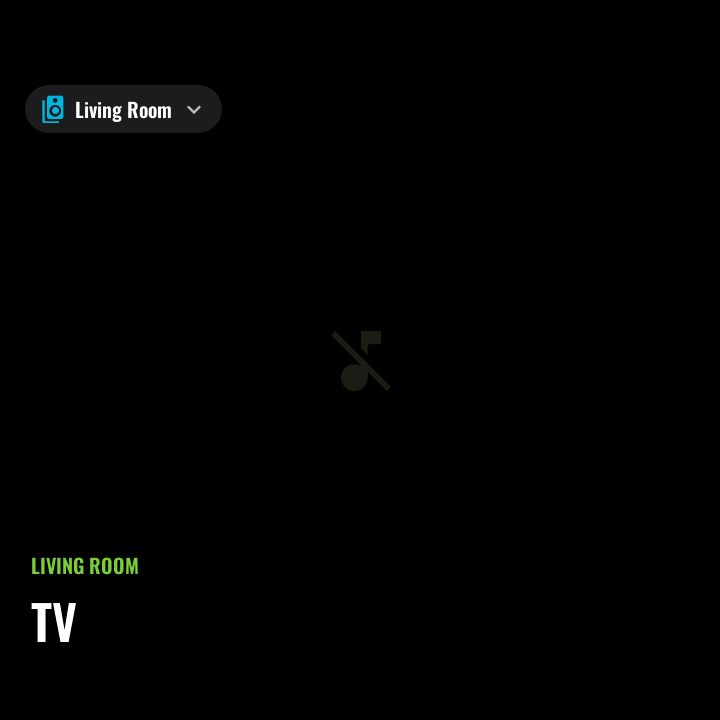
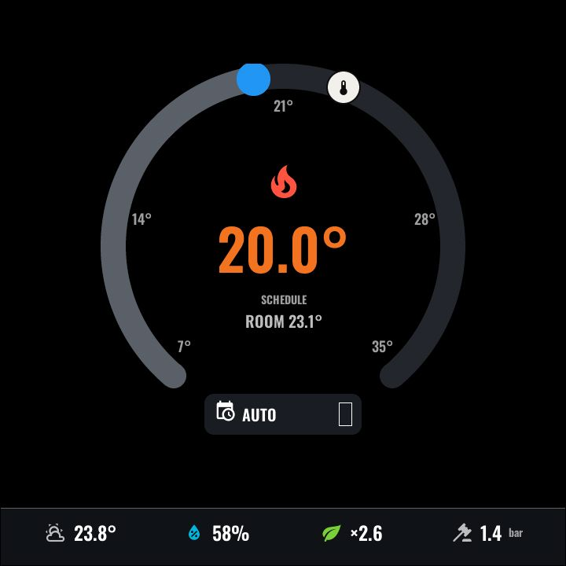
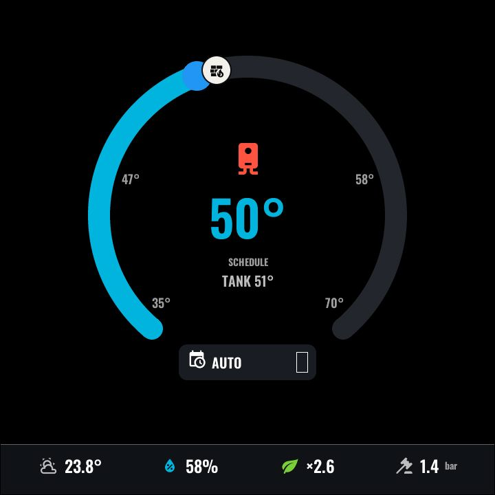
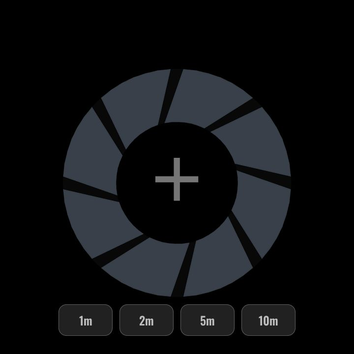
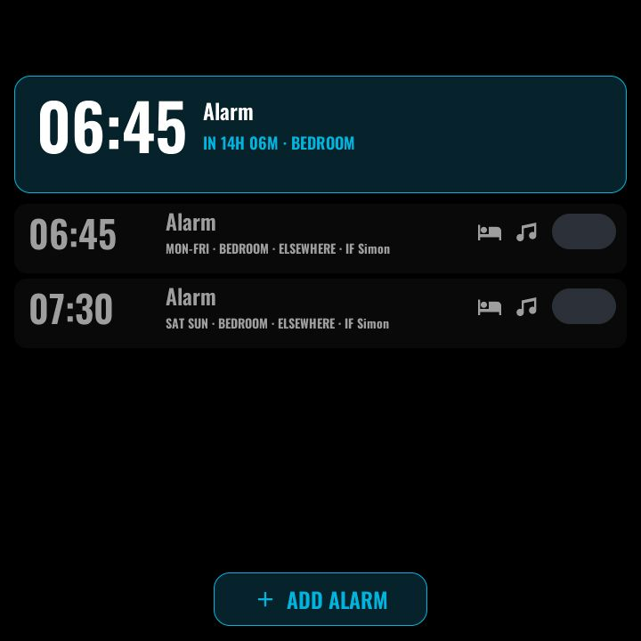
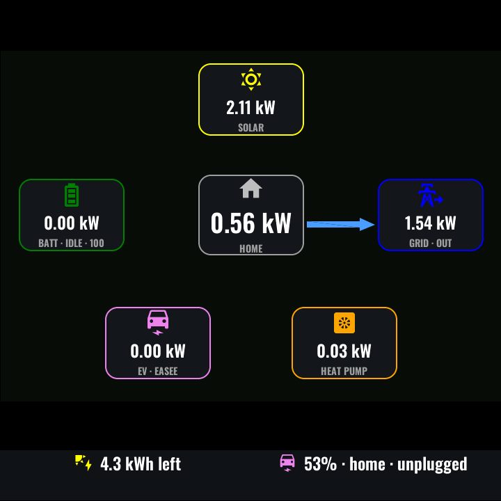
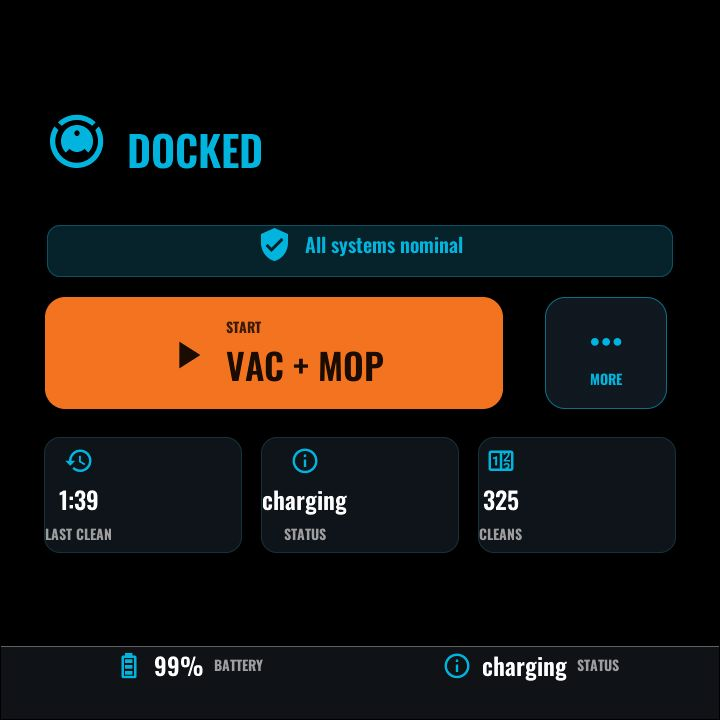
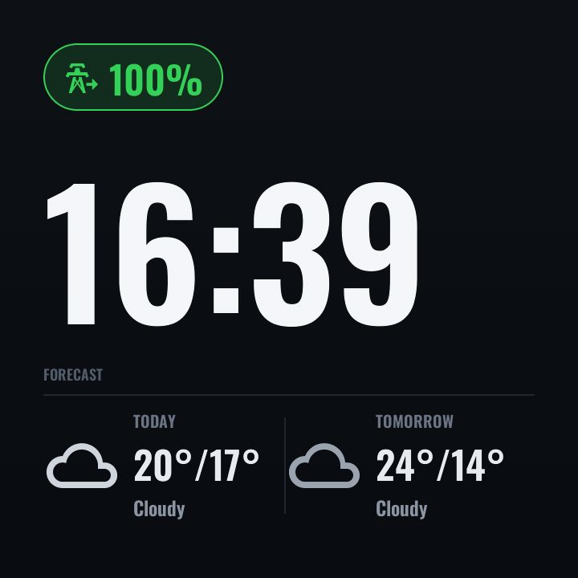
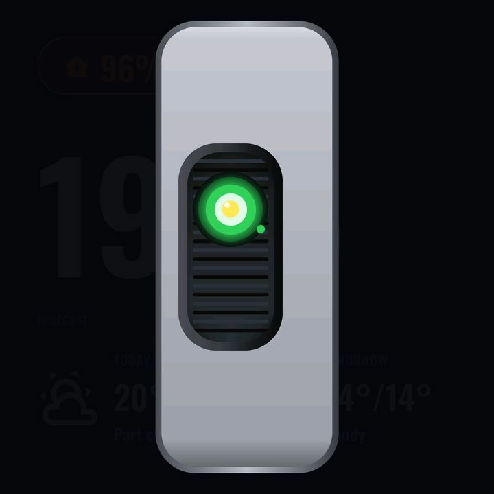

# Screens

One document per screen. The navigation model that ties them together —
functions, pages, swipes, the top bar and takeovers — is described in
[navigation.md](navigation.md); which screens a given panel actually carries is
your device file's choice (see [../CUSTOMISATION.md](../CUSTOMISATION.md)).

| Screen | What it is | |
|---|---|---|
| [Main / Now Playing](main.md) | The home screen: full-bleed album art, transport overlay, music pickers |  |
| [Multi-room audio](media.md) | Speaker-group grid: group, ungroup and set volume per room |  |
| [Climate](climate.md) | Room-temperature dial with draggable setpoint and heat-pump stats |  |
| [Hot water](hotwater.md) | Tank-temperature dial with one-tap boost |  |
| [Timer](timer.md) | Aperture-iris countdown, shared between touch and voice |  |
| [Alarm](alarm.md) | HA-backed alarm roster with speaker/music/person pickers |  |
| [Energy](energy.md) | Live power Sankey plus a daily-totals view |  |
| [Surf conditions](swelligence.md) | Manifest-generated spot pages with per-sport suitability |  |
| [Room](room.md) | Per-room tile grid (stub) |  |
| [Vacuum](vacuum.md) | Robot-vacuum state hero, progress and routine picker |  |
| [Screensaver](screensaver.md) | Terminal-style monumental clock with a two-day forecast |  |
| [Voice overlay](voice.md) | Animated persona showing the voice assistant's state |  |
| [Info](info.md) | Device/network details via the settings cog | — |
| [Navigation](navigation.md) | The 2D swipe model, dot rails, top bar and takeover framework | — |
