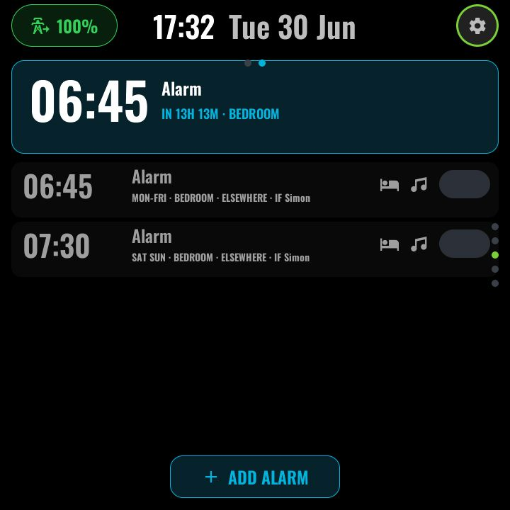

# Alarm

*With top-layer chrome:*

The second page of the TIMER function (swipe left from [Timer](timer.md)).
Wake-up alarms that play **music on a room speaker**, with the schedule owned
by Home Assistant — the panel is a front-end over an HA helper backend, so
alarms survive panel reboots and can also be managed by voice or automations.

### The list

- A **next-alarm hero** at the top, then up to four alarm rows painted from the
  dynamic roster (`sensor.scheduled_alarms`, attributes `a0`–`a5` plus `next`).
- Rows whose target speaker is *not* this panel's room group render **muted**
  ("elsewhere" alarms — visible but visually secondary).
- An **Add** affordance creates a new alarm in the first free slot.
- The roster reading empty just means the HA backend package is not installed
  yet — it is not a wiring error.

### Editing — takeover pages

Tapping a row (or Add) enters a chain of full-screen takeovers
([navigation](navigation.md#takeovers)):

| Takeover | What it does |
|---|---|
| **Edit** | HH:MM steppers, seven day-of-week chips, enable toggle, Save, and three CTAs into the pickers below. No free-text field — names are set by voice if wanted. |
| **Speaker** | Room picker (the roster below) plus a **wake volume** slider. |
| **Music** | Playlist cover grid (from the shared Spotify feed) or Default Sound. |
| **Who** | Person picker rendered from `person.*` entity pictures — used so automations can skip an alarm when that person is away. |

### Ringing

A top-layer **ringing overlay** appears over *any* page while
`input_text.alarm_ringing` is non-empty, with **Snooze** and **Dismiss** —
both write straight back to the HA backend (`input_boolean.alarm_snooze_armed`
etc.), which owns the actual snooze/dismiss logic.

### Configuration (user-config.yaml)

The speaker picker reuses the media roster's slugs so the two lists cannot
drift; rows carry their own labels and glyphs. Row 0 is always the panel's own
room.

| Substitution | Meaning | Example |
|---|---|---|
| `alarm_room_player` | This panel's own speaker entity | `media_player.${media_local_slug}` |
| `alarm_local_label` | Label for the local room | `"Living Room"` |
| `alarm_row_0..5_slug` | Speaker slug per picker row | `kitchen` |
| `alarm_row_0..5_label` | Row caption | `"Kitchen"` |
| `alarm_row_0..5_glyph` | Row MDI glyph | `$mdi_fridge` |
| `spotify_playlists_entity` | Playlist feed for the music picker | `sensor.spotify_panel_playlists` |

### Home Assistant entities

- `sensor.scheduled_alarms` (attributes `a0`–`a5`, `next`), the per-slot
  helper entities the takeovers write
  (`input_text` / `input_number` / `input_boolean` / `input_datetime`), and the
  ringing plumbing (`input_text.alarm_ringing`,
  `input_boolean.alarm_snooze_armed`) — all from
  [`homeassistant/examples/alarm_panel.yaml`](../../homeassistant/examples/alarm_panel.yaml).
- `person.*` entities with photos for the Who picker.
- `media_player.<slug>` for each picker row.

---
[← Timer](timer.md) · Next: [Energy →](energy.md) · [Back to customisation](../CUSTOMISATION.md)
