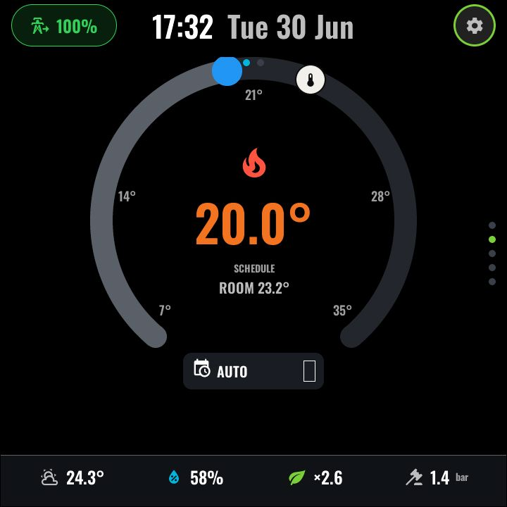

# Climate

*With top-layer chrome:*

The first page of the CLIMATE function. A room-thermostat dial built for a
heat-pump home:

- An **open-bottom arc (~280°)** spans the configured temperature range, with a
  **draggable target knob** — release commits the setpoint via
  `climate.set_temperature` (clamped to `climate_min_temp`/`climate_max_temp`
  so an out-of-range drag can never write garbage to the thermostat).
- A **current-temperature marker** sits on the same scale.
- The **centre state glyph** shows heating state — flame (red) when heating,
  grey when idle.
- A **mode dropdown** in the arc's cut-out switches between
  AUTO / BOOST / AWAY / OFF (BOOST drives the quick-veto duration number).
- The **common bottom bar** (shared with [Hot water](hotwater.md)) shows four
  stats: Outdoor · Humidity · COP · Pressure.

### Interactions

| Gesture | Effect |
|---|---|
| Drag the knob | Set target temperature (commits on release) |
| Mode dropdown | Change HVAC/preset mode |
| Swipe left | [Hot water](hotwater.md) |
| Swipe up / down | Adjacent functions |

### Configuration (user-config.yaml)

| Substitution | Meaning | Example |
|---|---|---|
| `climate_entity` | The thermostat to control | `climate.living_room` |
| `climate_min_temp` / `climate_max_temp` | Dial range — **must match the entity's own min/max** or setpoint writes are rejected | `"7.0"` / `"35.0"` |
| `clim_qv_duration_entity` | Quick-veto (boost) duration number | `number.heating_quick_veto_duration` |
| `clim_outdoor_entity` | Outdoor temperature stat | `sensor.outdoor_temperature` |
| `clim_humidity_entity` | Indoor humidity stat | `sensor.indoor_humidity` |
| `clim_cop_entity` | Heat-pump efficiency (COP) stat | `sensor.heating_energy_efficiency` |
| `clim_pressure_entity` | System water pressure stat | `sensor.system_water_pressure` |

### Home Assistant entities

Any standard `climate.*` entity works for the dial. The four bottom-bar stats
and the quick-veto number are whatever your heating integration exposes (the
reference setup uses a Vaillant heat pump); leave a stat's entity unset/missing
and its cell simply reads empty.

---
[← Multi-room audio](media.md) · Next: [Hot water →](hotwater.md) · [Back to customisation](../CUSTOMISATION.md)
