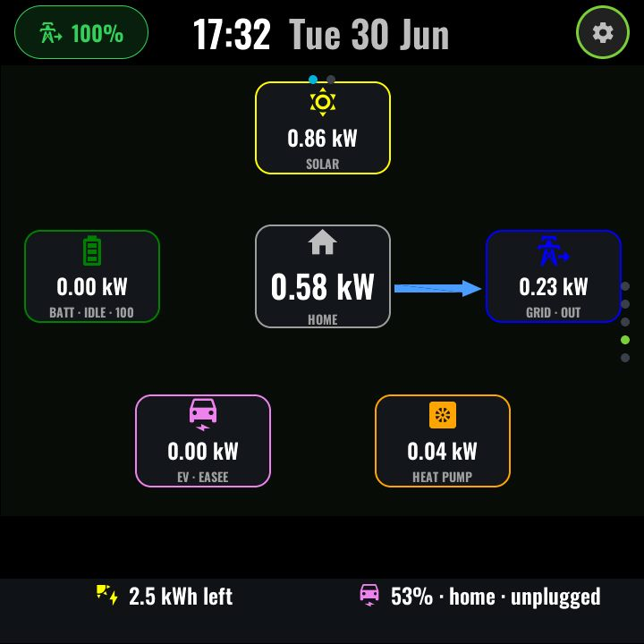
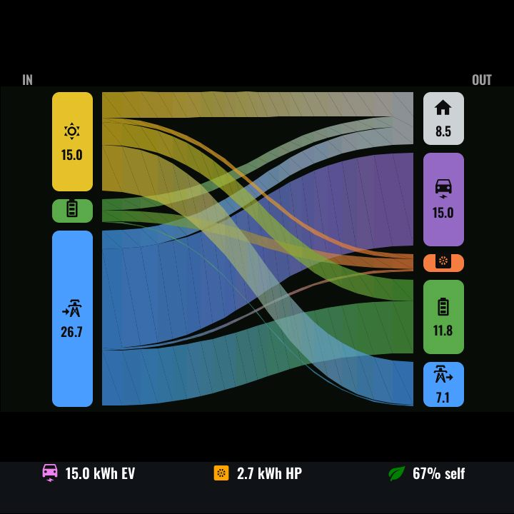
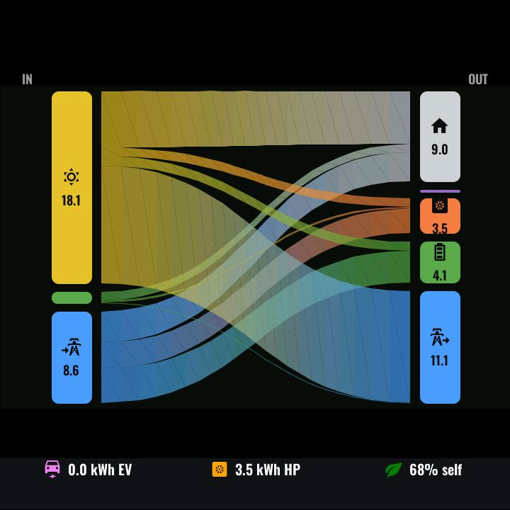

# Energy

*With top-layer chrome:*

The ENERGY function: two pages that make a solar + battery + EV + heat-pump
home legible at a glance. Everything is drawn with LVGL-honest primitives —
canvas-filled ribbons and label/MDI nodes, no SVG — and the decorative layers
are non-clickable so swipes pass straight through.

### Page 1 — Now (live Sankey)

Live power flows between the system nodes — **PV**, **Home**, **Grid**,
**Battery**, **EV charger** and **heat pump** — with ribbon widths and arrows
following the instantaneous readings. A foot strip adds context: solar
forecast remaining today and the EV's battery level. The page binds straight
to your inverter/charger integration's entities — grid is one signed net power
sensor — and normalises units and signs on the panel (`en_power_scale`,
`en_batt_sign`, `en_grid_sign`), so no HA template sensors are needed whatever
the brand's convention.

The top bar's battery pill (visible on every page) is fed from the same
sensors — tapping it jumps here from anywhere.

### Page 2 — Today (daily Sankey)

Swipe left for the day's *totals*: a Sankey of energy moved along each
source→destination path since midnight (PV/Battery/Grid →
Home/Battery/Grid/EV/Heat-pump). The panel asks HA's recorder for today's
5-minute changes on the same kWh counters your Energy dashboard uses
(`recorder.get_statistics`, on HA connect and every 5 minutes). HA splits each
5-minute bucket the way its energy-distribution card does — PV's export and
battery charge come first and the rest of PV serves the home; any export or
charge PV cannot cover is attributed grid→battery, then battery→grid — and
the EV and heat pump take a share of each source in proportion to that
bucket's home mix. The bucket totals are summed, so time-of-day patterns
(e.g. overnight grid charging) are kept, and the paths land close to
per-second flow meters. Short-term statistics compile every 5 minutes and the
panel polls unaligned, so totals trail live readings by up to ~10 minutes.

*Reference rendering of the daily Sankey:*

### Configuration (user-config.yaml)

| Substitution | Meaning | Example |
|---|---|---|
| `en_power_scale` | Unit of every power entity: `1` = kW, `0.001` = W | `"1"` |
| `en_batt_sign` | `1` if battery power is +charge / −discharge, `-1` if reversed | `"1"` |
| `en_grid_sign` | `1` if grid power is +import / −export, `-1` if reversed | `"1"` |
| `en_pv_power_entity` | Live PV generation | `sensor.pv_power` |
| `en_consumed_power_entity` | Live house consumption (optional — if the entity never reports, load is derived as PV + grid − battery) | `sensor.house_power` |
| `en_grid_power_entity` | Live grid power, one signed net sensor | `sensor.grid_power` |
| `en_ev_power_entity` | EV charger power | `sensor.ev_charger_power` |
| `en_ev_status_entity` | EV charger status text | `sensor.ev_charger_status` |
| `en_hp_power_entity` | Heat-pump power | `sensor.heat_pump_power` |
| `en_solcast_remaining_entity` | Solar forecast remaining today (kWh) | `sensor.solar_forecast_remaining_today` |
| `en_tesla_soc_entity` | EV battery level (%) | `sensor.ev_battery_level` |
| `en_tesla_location_entity` | EV location tracker (home/away gates the EV node) | `device_tracker.ev_location` |
| `en_pv_energy_entity` | PV production counter (kWh, Energy dashboard) | `sensor.pv_energy_total` |
| `en_grid_import_energy_entity` / `en_grid_export_energy_entity` | Grid import / export counters | `sensor.grid_import_energy_total` |
| `en_batt_charge_energy_entity` / `en_batt_discharge_energy_entity` | Battery charge / discharge counters | `sensor.battery_charge_energy_total` |
| `en_ev_energy_entity` / `en_hp_energy_entity` | EV charger / heat-pump counters (optional, `""` = none) | `sensor.ev_charger_energy_total` |

The battery pill and battery node read the shared battery sensors declared in
`ui-shared.yaml` — bind `battery_power_entity` (signed battery power, scaled
and signed by the same `en_power_scale` / `en_batt_sign`) and
`battery_soc_entity` (%) in the same config.

### Home Assistant entities

- Live node powers from your inverter/charger integrations (any brand — the
  substitutions decouple the page from specific integrations).
- The kWh counters already configured in HA's Energy dashboard (they must have
  long-term statistics, i.e. `state_class: total` / `total_increasing`).
- No HA packages or template sensors. The Today view needs HA ≥ 2025.10 and
  "Allow the device to perform Home Assistant actions" on the ESPHome
  integration entry.

---
[← Alarm](alarm.md) · Next: [Surf conditions →](swelligence.md) · [Back to customisation](../CUSTOMISATION.md)
