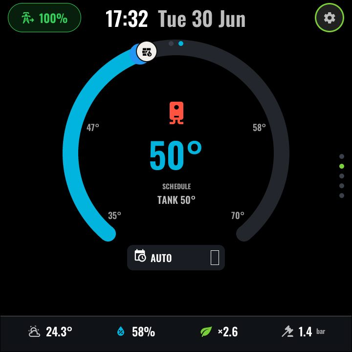

# Hot water

*With top-layer chrome:*

The second page of the CLIMATE function (swipe left from
[Climate](climate.md)). The same dial language as the room thermostat, adapted
for a domestic hot-water (DHW) tank:

- A **display-only tank dial** — the arc shows current tank temperature against
  the 35–65 °C scale with the setpoint marked. The setpoint itself is *not*
  draggable here: on most heat-pump installations DHW setpoint is owned by the
  boiler/heat-pump controller, so the panel deliberately reads rather than
  writes it.
- A **centre boiler glyph** reflects heating state.
- A **BOOST button** in the dial cut-out — the one write this page performs —
  toggles the DHW boost switch for an immediate heat-up.
- The **common bottom bar** is shared with the climate page:
  Outdoor · Humidity · COP · Pressure.

### Interactions

| Gesture | Effect |
|---|---|
| BOOST | Toggle `dhw_boost_switch` |
| Swipe right | [Climate](climate.md) |
| Swipe up / down | Adjacent functions |

### Configuration (user-config.yaml)

| Substitution | Meaning | Example |
|---|---|---|
| `dhw_tank_temp_entity` | Current tank temperature | `sensor.hot_water_tank_temperature` |
| `dhw_setpoint_entity` | Tank setpoint (read-only display) | `sensor.hot_water_setpoint` |
| `dhw_boost_switch` | Boost switch the CTA toggles | `switch.hot_water_boost` |
| `dhw_wh_entity` | The `water_heater` entity (operating state) | `water_heater.hot_water` |
| `clim_outdoor_entity` / `clim_humidity_entity` / `clim_cop_entity` / `clim_pressure_entity` | Shared bottom-bar stats (see [climate.md](climate.md)) | |

### Home Assistant entities

Whatever your heating integration exposes for DHW — a temperature sensor, a
setpoint sensor, a boost switch and a `water_heater` entity. All are optional
individually; missing ones render as empty values.

---
[← Climate](climate.md) · Next: [Timer →](timer.md) · [Back to customisation](../CUSTOMISATION.md)
