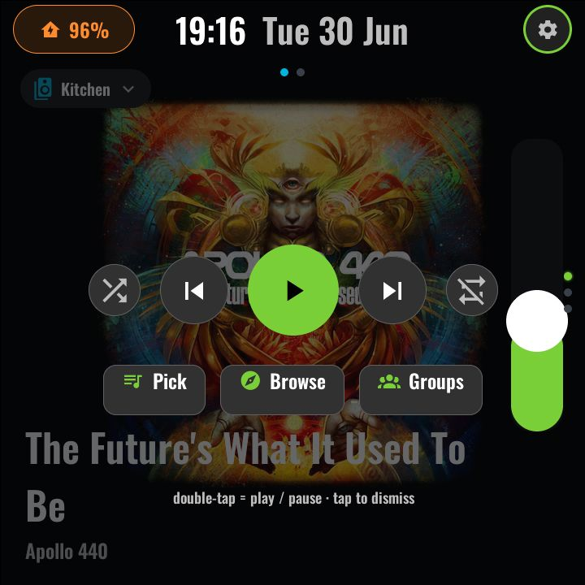
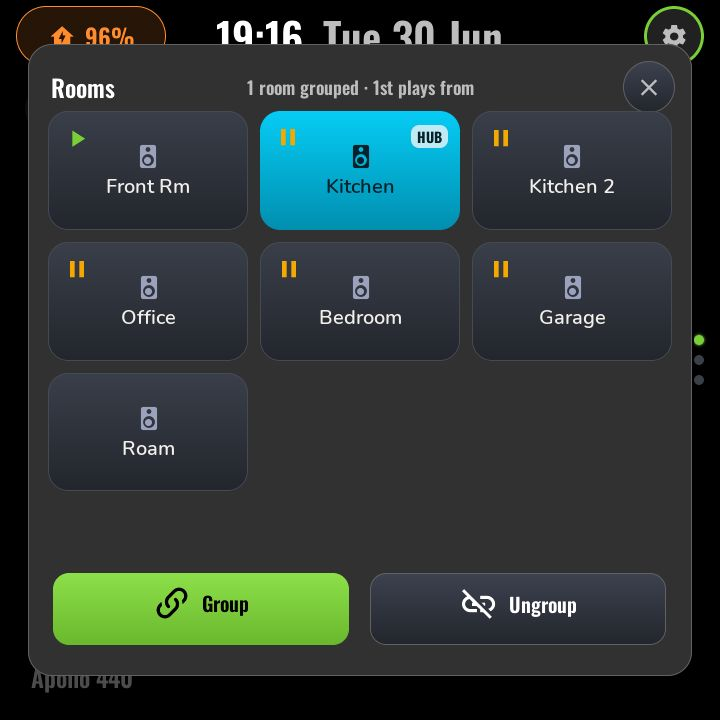
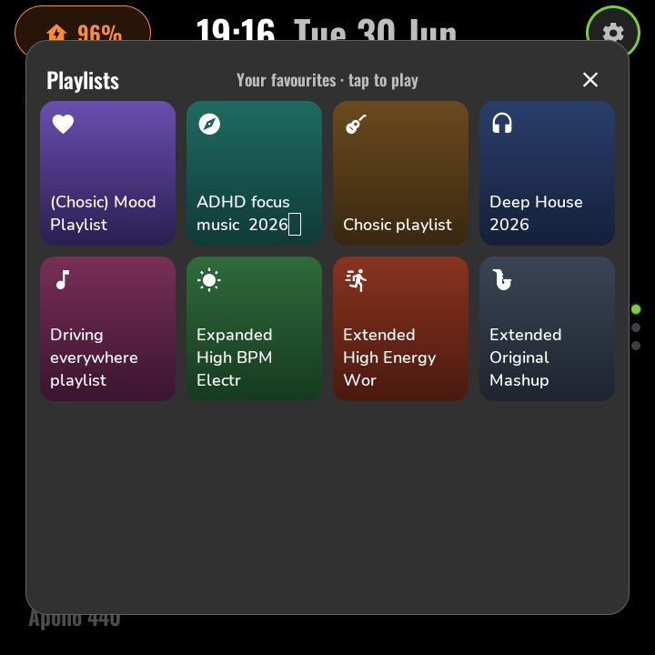

# Main — Now Playing

*With top-layer chrome (top bar, nav dots):*

The home screen (function 0, page 0 — where the panel boots and where the HOME
gesture lands). It is the music surface, with three visual states:

- **IDLE** — nothing playing: a "Nothing playing" landing with three launch
  tiles (**Pick Music**, **Browse**, **Rooms**) and a row of recently-played
  covers (tap a cover to play it).
- **PLAYING** — full-bleed 480 px album art fetched via `online_image`, a ghost
  top bar overlaid by the singleton chrome, and source · title · artist in the
  bottom-left.
- **TAPPED** — a ~62% dim overlay with the transport
  (shuffle / previous / play-pause / next / repeat), a horizontal volume
  slider, the Pick / Browse / Rooms quick-launch tiles, and a **Follow-Me**
  toggle (the panel's own `switch.<panel_name>_follow_me`) for
  hand-off-as-you-move-room setups.

### Interactions

| Gesture | Effect |
|---|---|
| Single tap | Toggle the transport overlay (PLAYING ↔ TAPPED) |
| Double tap (anywhere) | Play / pause |
| Swipe left | [Multi-room audio](media.md) (page 1 of this function) |
| Swipe up / down | Previous / next function ([navigation](navigation.md)) |
| Pick Music / Browse tiles | Enter the full-screen picker takeovers (playlist grid / artist drill-down) |
| Rooms tile | Open the Rooms grouping modal |

### Modals and takeovers

The pickers and modals are provided by the media backend module
(`modules/page-media.yaml`) and drawn on the top layer:

| | |
|:---:|:---:|
|  Transport + volume overlay |  Rooms grouping — the highlighted tile is the group coordinator, outlined tiles are staged members |
|  Playlists / favourites grid | |

### Configuration (user-config.yaml)

| Substitution | Meaning | Example |
|---|---|---|
| `media_mirror_entity` | Active-media mirror sensor — state drives play/pause glyph; attributes feed title/artist/device/volume/artwork | `sensor.panel_active_media` |
| `active_player_helper` | `input_text` naming the panel's active player | `input_text.panel_active_player` |
| `spotify_recent_entity` | Recently-played feed for the cover row | `sensor.spotify_panel_recent` |
| `spotify_playlists_entity` | Playlist feed for Pick Music | `sensor.spotify_panel_playlists` |
| `spotify_artists_entity` | Artist feed for Browse | `sensor.spotify_panel_artists` |
| `ha_base_url` / `imageproxy_url` | Where album art is fetched from | `http://homeassistant.local:8123` |
| `media_local_slug` | This panel's default play target | `living_room` |

### Home Assistant entities

- `sensor.panel_active_media` + `input_text.panel_active_player` — from
  [`homeassistant/examples/media_mirror.yaml`](../../homeassistant/examples/media_mirror.yaml)
  (one package per panel).
- `sensor.spotify_panel_*` — from
  [`homeassistant/examples/spotify_panel.yaml`](../../homeassistant/examples/spotify_panel.yaml).
- Follow-Me is a switch on the panel itself (`switch.<panel_name>_follow_me`,
  restored across reboots, default OFF); no HA helper is needed. An external
  follow-me automation must read that switch — the old
  `input_boolean.sonos_follow_me` is no longer written by the panel.
- `media_player.*` for each roster room (see [media.md](media.md)).

If Home Assistant is unreachable at boot, the splash screen self-dismisses
after 12 s and this page runs in its IDLE state; the settings cog's ring shows
red until the API connects.

---
Next: [Multi-room audio →](media.md) · [Back to customisation](../CUSTOMISATION.md)
