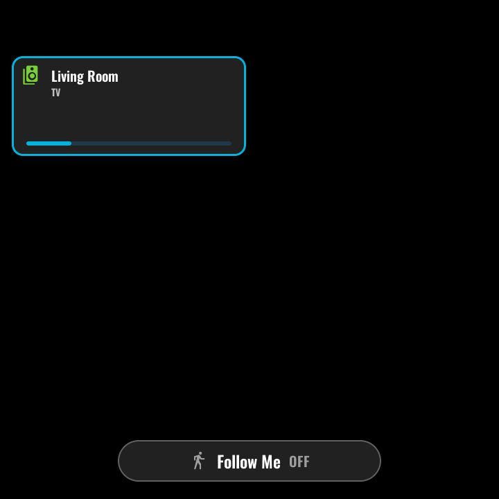
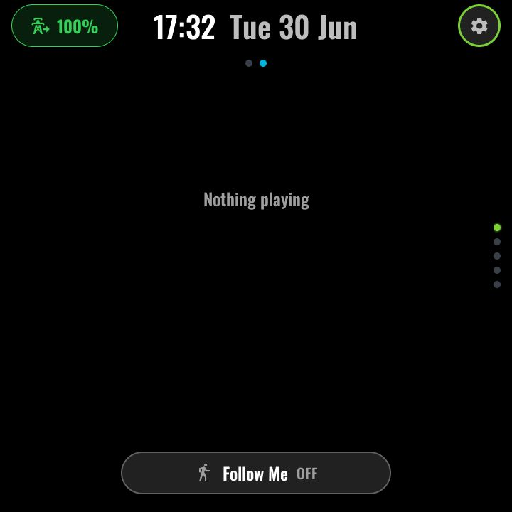

# Multi-room audio

*With top-layer chrome:*

The second page of the MAIN function (swipe left from
[Now Playing](main.md)). Each configured speaker is a row:

- The **speaker glyph is the group toggle** — green when the room is grouped
  with the active coordinator, grey when not; tapping it joins or unjoins the
  room.
- The **room name** renders green when that room is the active target.
- A **volume bar** per row sets that room's volume directly.
- A **now-playing mini-dock** (bottom ~25% of the screen) shows the current
  track with previous / play-pause / next transport.

Group state is live: the panel derives it from each room's `group_members`
(a room whose `group_members[0]` is itself is a coordinator) and repaints as
soon as HA reports speakers grouping or ungrouping, whoever initiated it — no
polling.

### The media backend

The module behind this page (`modules/page-media.yaml`) is also the panel's
media *backend*: it owns the now-playing sensors (state / title / artist /
device), the volume sensor, the active-target resolver, the `media_play_uri`
script, the dock transport scripts, and the Rooms / Playlists modals used from
[Main](main.md). Each roster room's `media_player` is bound directly
(`modules/media-room.yaml`, one package per slot); now-playing shows the
selected room, and the playback target is that room's group coordinator
(`group_members[0]`). The selection lives on the panel (restored across
reboots), so HA automations can no longer repoint a panel. It stays included even on panels that restyle the front-end
pages.

### Configuration (user-config.yaml)

The grid has a **fixed slot count of 7** (LVGL widgets are compile-time), but
which rooms fill the slots is yours to choose. A *slug* is the entity id minus
the `media_player.` prefix.

| Substitution | Meaning | Example |
|---|---|---|
| `media_local_slug` | This panel's own room — the default play target | `living_room` |
| `media_room_0_slug` … `media_room_6_slug` | Speaker slug per slot | `kitchen`, `office`, … |
| `media_room_0_caption` … `media_room_6_caption` | Row/tile caption | `"Kitchen"` |

Keep slug/caption pairs aligned — slot order also maps topology state onto
tiles.

### Home Assistant entities

- `media_player.<slug>` for every roster slot (any grouping-capable players;
  the reference setup uses Sonos).
  Each is bound directly for state, `media_title`, `media_artist`,
  `entity_picture`, `volume_level`, `group_members` and `media_content_id`
  (an `x-sonos-htastream` / `x-rincon-stream:` content id marks TV /
  line-in). No HA package is needed. Only these 7 rooms are seen: a
  group led by a speaker outside the roster still shows (via a roster member),
  but a group made only of unlisted speakers does not.

---
[← Main / Now Playing](main.md) · Next: [Climate →](climate.md) · [Back to customisation](../CUSTOMISATION.md)
