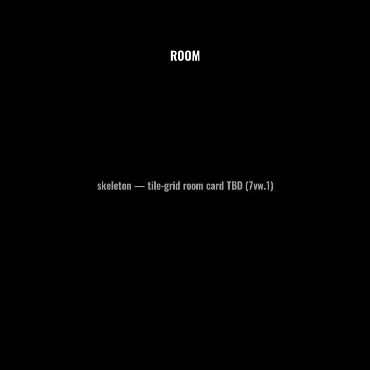
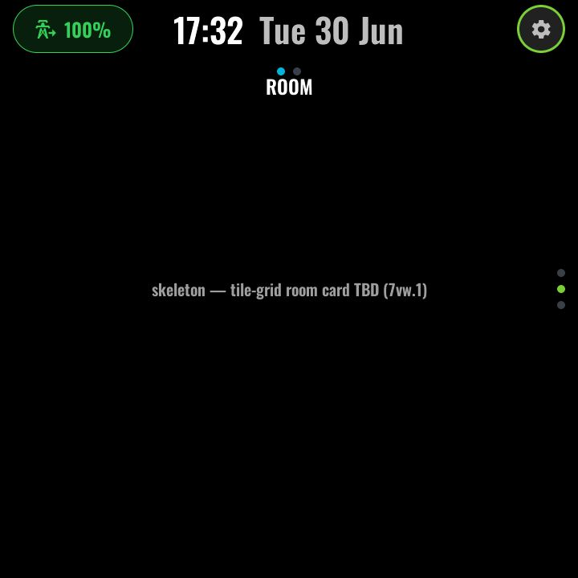

# Room

*With top-layer chrome:*

A per-room control card — the "everything in this room" page for secondary
panels (the example kitchen panel pairs it with [Vacuum](vacuum.md) on one
function row).

> **Status: stub.** The page currently renders a placeholder; the planned
> tile-grid room card (lights, switches and other room devices as toggle tiles)
> is not yet implemented. The page exists so the navigation contract, capture
> registration and per-panel composition are already in place — a panel can
> include it today and gain the content with a future update.

### Configuration (user-config.yaml / device file)

| Substitution | Meaning | Example |
|---|---|---|
| `room_nav_f` / `room_nav_p` | The page's coordinates in the nav grid, so the dot rails stay honest wherever a panel places it | `"1"` / `"0"` |

### Home Assistant entities

None yet — the tile roster will be substitution-driven like every other page
when the grid lands.

---
[← Surf conditions](swelligence.md) · Next: [Vacuum →](vacuum.md) · [Back to customisation](../CUSTOMISATION.md)
