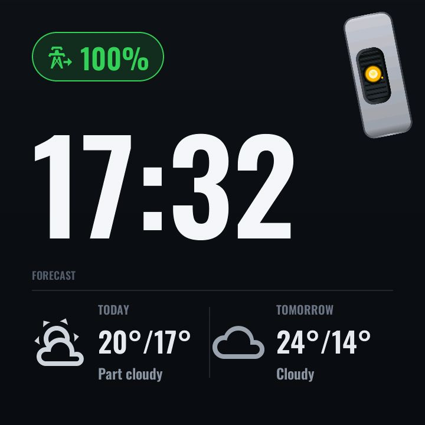
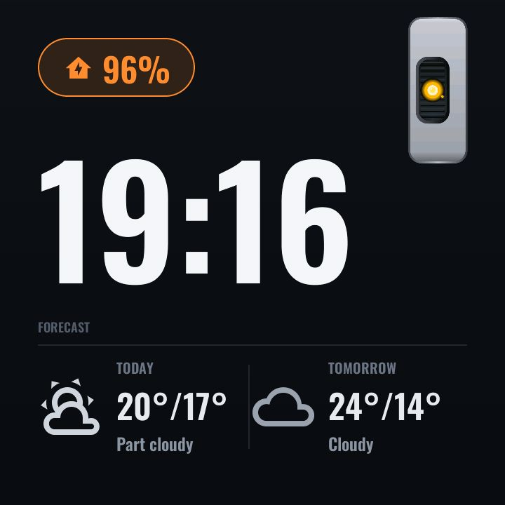

# Screensaver

*With top-layer chrome (battery pill):*

A "terminal" clock screensaver, shown automatically after **45 seconds of
inactivity** (LVGL `on_idle`) — the page is declared `skip: true`, so it never
appears in the swipe ring; idle is the only way in, and a tap anywhere returns
to [Main](main.md).

- A **monumental clock** — 216 px Oswald digits (the font is rasterised with
  digits and colon only, so even at that size it stays small in flash).
- A **two-day forecast** — Today and Tomorrow with condition glyph and hi/lo,
  covering the full range of HA weather conditions (sun, cloud, rain, snow,
  fog, lightning, hail…).
- The **battery pill** stays visible, painted by the same single top-bar
  painter used everywhere else, so the panel remains a glanceable energy
  display overnight.

### The GLaDOS cameo

While the screensaver is active and the voice assistant is idle, the
[voice persona](voice.md) parks itself as a small **idle cameo in the top-right
corner** — scaled down, transparent backdrop, with an organic tilt-and-look
behaviour pool so it feels alive without stealing focus. The character is a
non-commercial homage; see the attribution note in
[../../NOTICE.md](../../NOTICE.md).

*Idle cameo (`?modal=voice-idle`):*

### Configuration (user-config.yaml)

| Substitution | Meaning | Example |
|---|---|---|
| `weather_entity` | Any HA `weather.*` entity; the panel fetches its daily forecast itself | `weather.forecast_home` |

### Home Assistant entities

- `weather.*` (your `weather_entity`) — the panel calls the `weather.get_forecasts`
  action (daily) on API connect and every 30 minutes, and shows today and
  tomorrow. Requires Home Assistant 2025.10 or newer. If a fetch fails the
  screensaver keeps the last values.
- The battery pill reads the shared battery sensors (see
  [energy.md](energy.md)).

---
[← Vacuum](vacuum.md) · Next: [Voice overlay →](voice.md) · [Back to customisation](../CUSTOMISATION.md)
