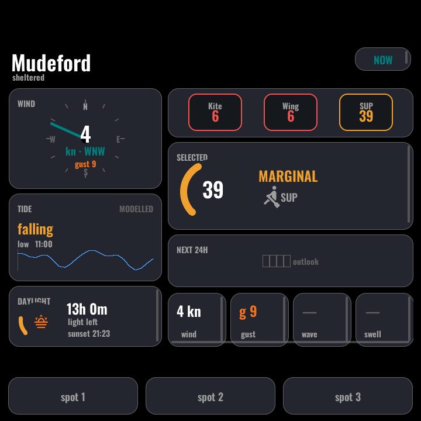
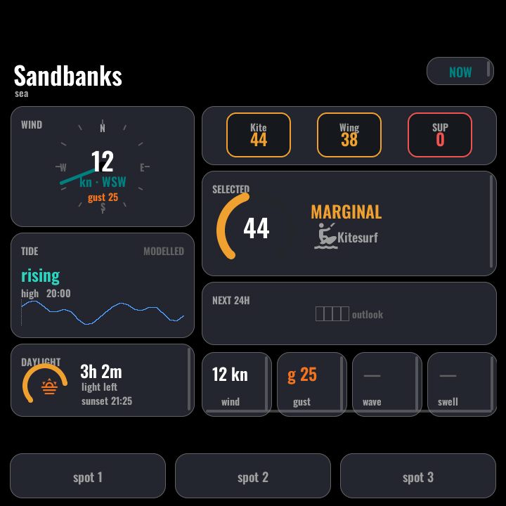
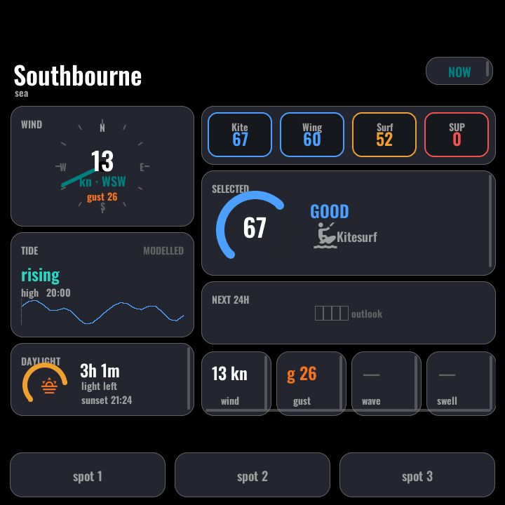

# Surf conditions (Swelligence)

| | | |
|:---:|:---:|:---:|
|  |  |  |

*(Design mockups — the on-device pages match these layouts; they are not
`:8080` captures.)*

The SWELLIGENCE function: one horizontally-swipeable page per surf/watersports
spot, showing live conditions and **per-sport suitability scores** from the
[Swelligence](https://github.com/f00lycooly/swelligence) Home Assistant
integration. Each spot page carries:

- A **headline** with the spot name and the best-scoring sport right now (the
  headline glyph switches at runtime between kitesurf / wing / surf / SUP
  markers).
- **Sport pills** — one per sport configured for that spot, coloured by
  suitability score. A sport the spot lacks simply never shows (its entity is
  `unavailable` — declaring the superset costs nothing).
- A **conditions strip** — wind/gust, tide, and sunset/daylight-remaining.

## Manifest-driven codegen

This function is **generated, not hand-written**. `swell-manifest.yaml` at the
repo root is the single source of truth:

```yaml
spots:            # one panel page per entry, in swipe order
  - slug: north_beach
    label: North Beach
  ...
sports:           # the pill superset
  - key: kitesurf
    label: Kite
  ...
```

Running `make generate` (or `python3 scripts/gen_swell_panel.py`) expands the
manifest into `modules/generated/swell-*.yaml`:

- per-spot `text_sensor`/`sensor` bindings,
- the LVGL spot pages themselves,
- capture-roster entries for the screenshot endpoint, and
- the function's **navigation row** (`${swell_npages}` / `${swell_matrix_row}`)
  consumed by the device file's nav contract.

Adding or removing a spot is therefore a manifest edit plus `make generate` —
no page YAML, no nav arrays. **Never hand-edit `modules/generated/`.**
`make validate` / `make compile` re-run the generator automatically.

### Configuration

| Where | Meaning | Example |
|---|---|---|
| `swell-manifest.yaml` `spots[]` | Spot slug + display label, in swipe order | `slug: north_beach` |
| `swell-manifest.yaml` `sports[]` | Sport key + pill label | `key: kitesurf` |

### Home Assistant entities

- `sensor.swelligence_<spot>_panel_detail` — the per-spot detail sensor the
  generated bindings subscribe to.
- `sensor.swelligence_<spot>_<sport>_suitability` — per-sport scores
  (sport slug derived from the sport label).

Both come from the Swelligence custom integration; panels without it can simply
omit this function from the device file's package list and nav contract.

---
[← Energy](energy.md) · Next: [Room →](room.md) · [Back to customisation](../CUSTOMISATION.md)
