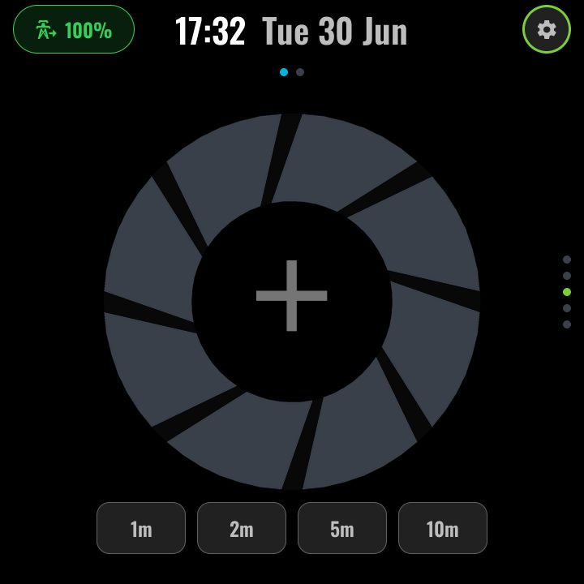
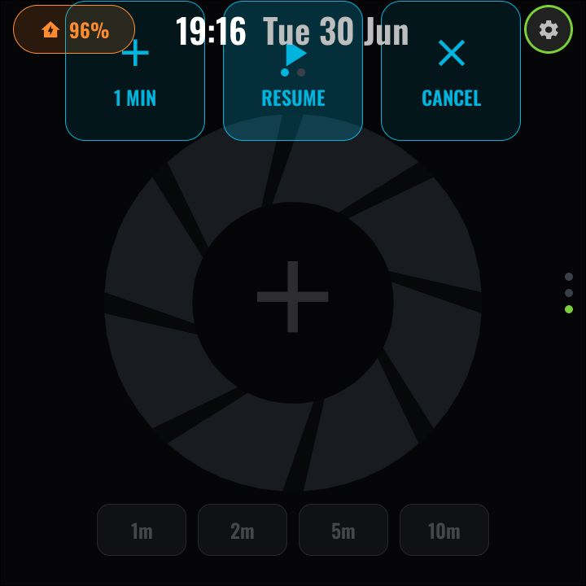

# Timer

*With top-layer chrome:*

The first page of the TIMER function. One kitchen timer, shared between touch
and voice — both drive the same Home Assistant `timer` helper, so a timer set
by voice shows here and a timer set here can be cancelled by voice.

### The aperture-iris animation

The centrepiece is a camera-iris gauge rendered from **pre-rotated PNG
layers** (the ESP32-P4's 2D accelerator does not do runtime rotation, so the
petals are baked): a static base plate, **eight single-blade petals** lit
one-at-a-time clockwise from the top seam, a separators plate, and the
remaining time centred in the opening. Progress maps to a discrete 8-step
petal count, and the petals are recoloured live to the mode colour — so a
running timer visibly "closes" the aperture as it counts down.

### States

- **IDLE** — blank aperture, a large centre **+** (opens the set-timer
  takeover) and quick-preset chips: **1m · 2m · 5m · 10m**.
- **RUNNING** — petals lit clockwise, time in the centre. Tap anywhere to
  pause and reveal the controls overlay: **+1 MIN · Resume · Cancel**.
- **PAUSED** — iris dimmed beneath the controls overlay.
- **FINISHED** — the panel chimes (on-device sound) and the
  [voice persona](voice.md) reacts; saying "stop" while it rings dismisses it
  (a dedicated wake-word model is enabled only while ringing).

*Controls overlay (`?modal=timerctrl`):*

### Setting a timer

The **+** button enters a full-screen takeover with an **HR : MIN : SEC
tumbler** (drum picker) and a start button — swipe navigation is suspended
until you confirm or back out ([takeover framework](navigation.md#takeovers)).

### Configuration (user-config.yaml)

| Substitution | Meaning | Example |
|---|---|---|
| `timer_entity` | The HA timer helper this panel drives — give each panel its own | `timer.living_room` |

### Home Assistant entities

- `timer.living_room` (or any HA timer helper you create: Settings → Devices &
  services → Helpers → Timer) — no package needed. To route voice-set timers
  into the same helper, add an `intent_script` bridge in your HA
  `configuration.yaml` (see the note at the top of `modules/page-timer.yaml`).

---
[← Hot water](hotwater.md) · Next: [Alarm →](alarm.md) · [Back to customisation](../CUSTOMISATION.md)
