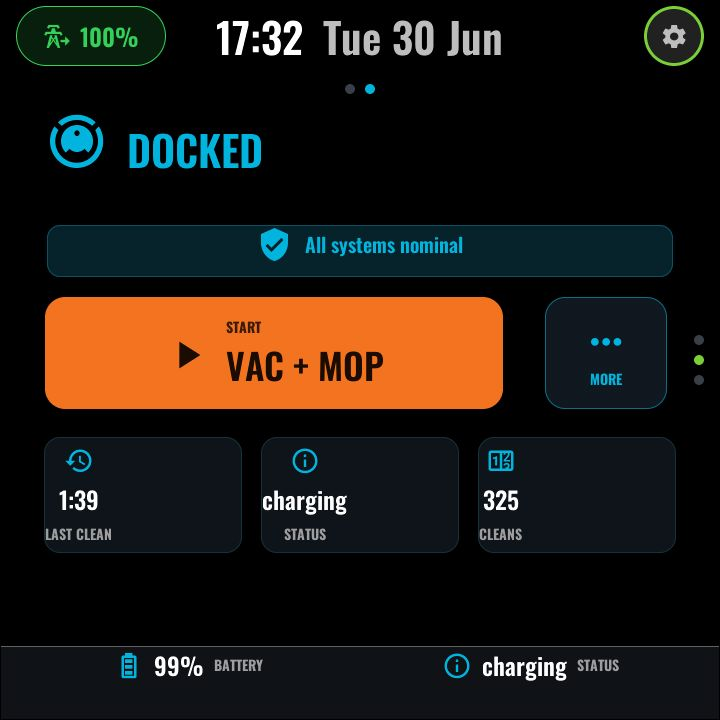
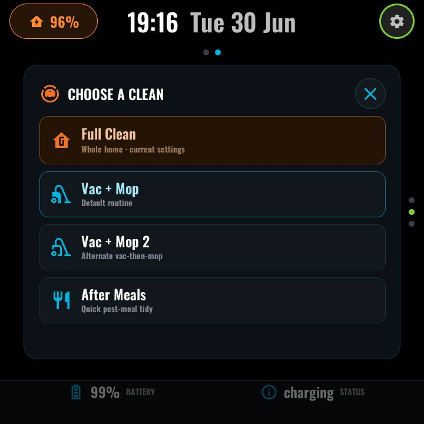

# Vacuum

*With top-layer chrome:*

A status-forward robot-vacuum page (built for a Roborock, but bound entirely
through substitutions). The whole UI is repainted by a single render script
from the HA sensors, so every element stays consistent:

- **State hero** — a large robot glyph plus the state word, colour-coded.
- **Progress bar** — shown only while cleaning.
- **Fault / OK banner** — aggregates the error sensors (vacuum error, dock
  error, water shortage, dirty/clean tank, mop/box attachment) into one line.
- **One context-aware split-primary control**:

  | Robot state | Primary | Secondary |
  |---|---|---|
  | Docked / idle | START *default routine* | MORE (opens the picker) |
  | Cleaning | DOCK (`vacuum.return_to_base`) | PAUSE |
  | Paused | RESUME (`vacuum.start`) | DOCK |

- **Session pills** — three context pills (current room · duration · progress
  while cleaning; last clean · status · total cleans while docked).

### "Choose a clean" modal

The MORE button opens a top-layer picker: **Full Clean** (`vacuum.start`,
whole home with current settings) plus three configurable **routine rows**,
each of which presses an HA `button` entity — point them at your saved
routines/scenes (e.g. Roborock's saved cleaning sequences exposed as buttons).

### Configuration (user-config.yaml / device file)

| Substitution | Meaning | Example |
|---|---|---|
| `vacuum_entity` | The `vacuum.*` entity | `vacuum.robot_vacuum` |
| `vacuum_battery_entity` | Battery % | `sensor.robot_vacuum_battery` |
| `vacuum_status_entity` | Detailed status text | `sensor.robot_vacuum_status` |
| `vacuum_room_entity` | Current room being cleaned | `sensor.robot_vacuum_current_room` |
| `vacuum_duration_entity` | Cleaning time this session | `sensor.robot_vacuum_cleaning_time` |
| `vacuum_progress_entity` | Cleaning progress % | `sensor.robot_vacuum_cleaning_progress` |
| `vacuum_total_entity` | Lifetime clean count | `sensor.robot_vacuum_total_cleaning_count` |
| `vacuum_error_entity` / `vacuum_dock_error_entity` | Error enum text sensors | `sensor.robot_vacuum_error` |
| `vacuum_water_shortage_entity`, `vacuum_dirty_tank_entity`, `vacuum_clean_tank_entity`, `vacuum_mop_attached_entity`, `vacuum_box_attached_entity` | Binary fault/attachment sensors | `binary_sensor.robot_vacuum_water_shortage` |
| `routine_default_entity` / `routine_default_label` | The primary button's routine | `button.robot_vacuum_vac_then_mop` / `"VAC + MOP"` |
| `clean_row_0..2_entity` / `_label` / `_sub` / `_glyph` | The three picker rows | `button.robot_vacuum_after_meals` |
| `vacuum_nav_f` / `vacuum_nav_p` | Nav-grid coordinates on this panel | `"1"` / `"1"` |

### Home Assistant entities

Everything above comes from your vacuum's integration (the reference setup is
a Roborock with its dock sensors). Missing fault sensors degrade to an
always-OK banner; missing session sensors leave their pills blank.

---
[← Room](room.md) · Next: [Screensaver →](screensaver.md) · [Back to customisation](../CUSTOMISATION.md)
