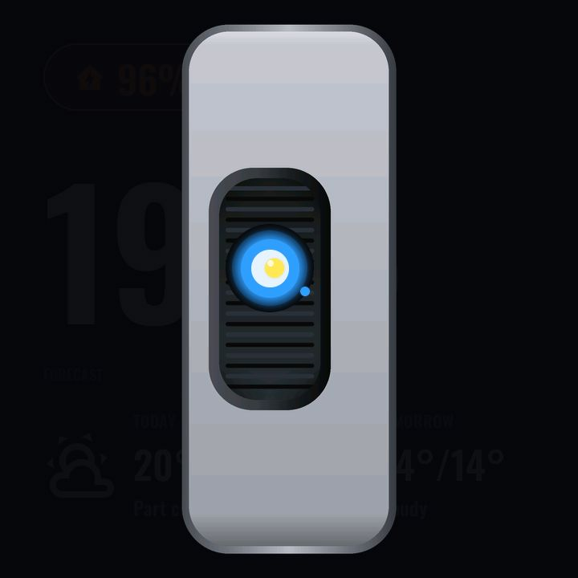
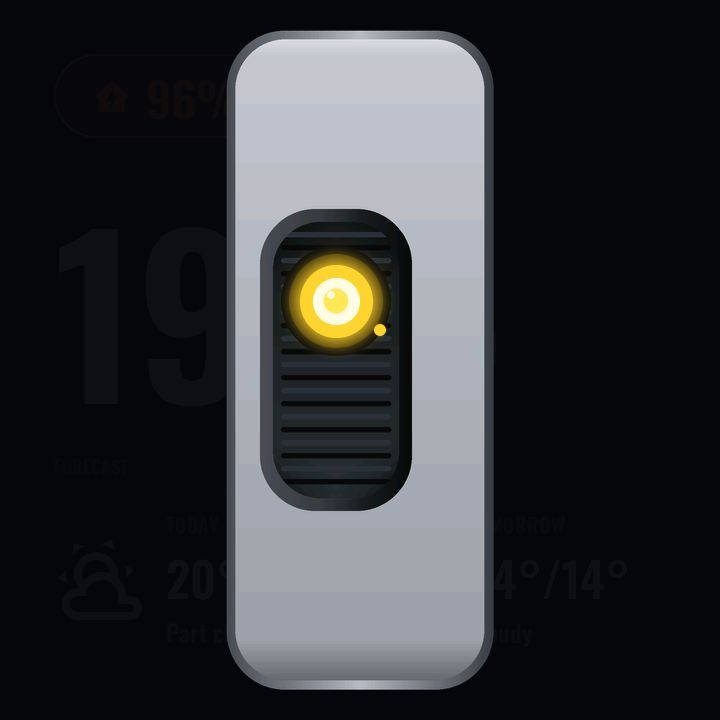
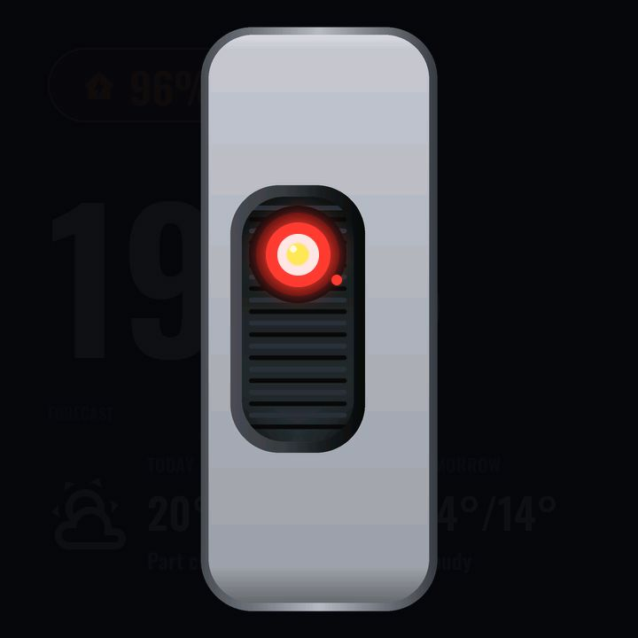

# Voice assistant overlay

The panel runs a full on-device voice pipeline (`modules/assist.yaml`):
micro-wake-word detection on the P4, speech streamed to Home Assistant's
Assist pipeline, replies played through the panel or a room speaker, plus
voice timers. The overlay documented here (`modules/voice-overlay.yaml`) is
its face — a full-screen top-layer persona that appears over whatever page is
showing whenever the assistant changes state.

### The persona

An animated **GLaDOS-style personality core** (a hand-crafted homage — see
[../../NOTICE.md](../../NOTICE.md)): a baked cavity/bellows layer at the back, a
live optic (socket, iris rings, hot core, pupil, glow, LED) in the middle, and
a ceramic faceplate in front whose cut-out aperture *is* the mask — the eye
slides vertically inside it and changes colour per phase. The heavy pieces are
pre-rendered rasters generated by a scripted chassis builder, so the live
animation stays cheap enough to run full-screen on the P4.

### Phases

| Phase | Eye | Screenshot |
|---|---|---|
| Idle (cameo) | dim, parked in the corner over the [screensaver](screensaver.md) |  |
| Listening | green |  |
| Thinking | blue |  |
| Replying | amber |  |
| Error | red |  |

Two extra phases back the [timer](timer.md): *timer finishing* and *timer
finished* — while a timer rings, a dedicated "stop" wake-word model is enabled
so saying **"stop"** dismisses it (the model is disabled the rest of the time,
so "stop" in conversation does not trigger anything).

In **active** phases the persona is centred and full-size over a dark
backdrop, auto-hiding when the assistant returns to idle. In **idle** it only
appears as the screensaver cameo — never over working pages.

### Architecture note

`assist.yaml` (the pipeline) is deliberately LVGL-free and shares nothing with
the overlay except one integer: `voice_assistant_phase`. The overlay owns all
presentation. That is the same separation every page package uses, and it means
a panel can take the voice stack without the persona, or neither (the example
hallway panel omits both packages entirely).

### Configuration (user-config.yaml)

| Substitution | Meaning | Example |
|---|---|---|
| `external_media_player` | Room slug seeding the voice reply/announce target speaker on first boot (runtime-editable via the panel's `target_speaker` text entity afterwards) | `living_room` |
| `ha_base_url` | Origin for externally-hosted sounds | `http://homeassistant.local:8123` |

Wake/notify/timer sounds are vendored FLAC files under `assets/sounds/` — no
network dependency for the built-in chimes.

### Home Assistant prerequisites

A configured **Assist pipeline** (any conversation agent + STT/TTS you like).
The panel appears in HA as a voice satellite once added; timers spoken to the
panel land in the shared HA timer once you add an `intent_script` bridge in
your HA `configuration.yaml` (see the note at the top of
`modules/page-timer.yaml`).

---
[← Screensaver](screensaver.md) · Next: [Info →](info.md) · [Back to customisation](../CUSTOMISATION.md)
